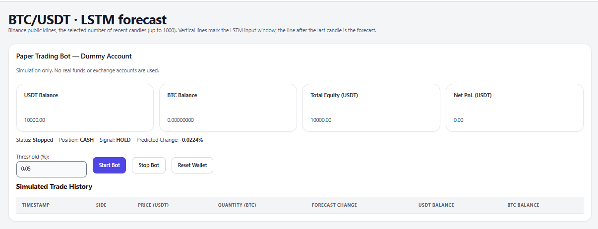
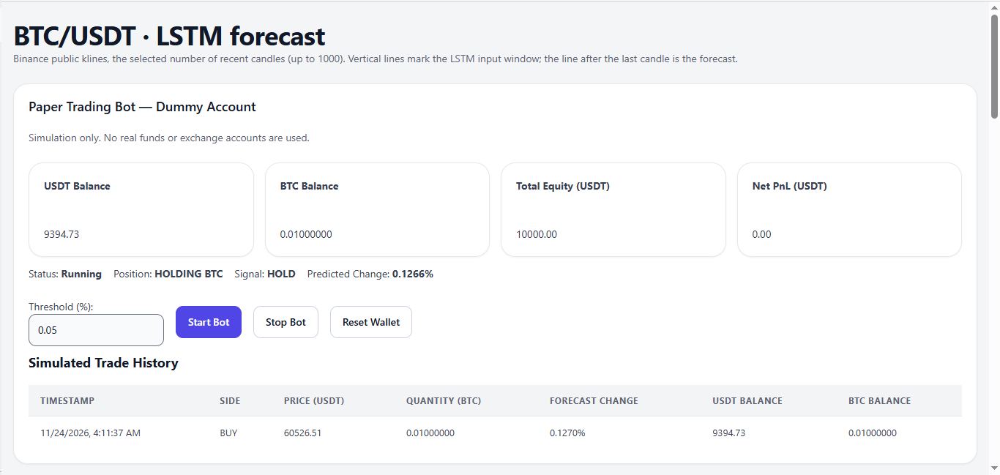
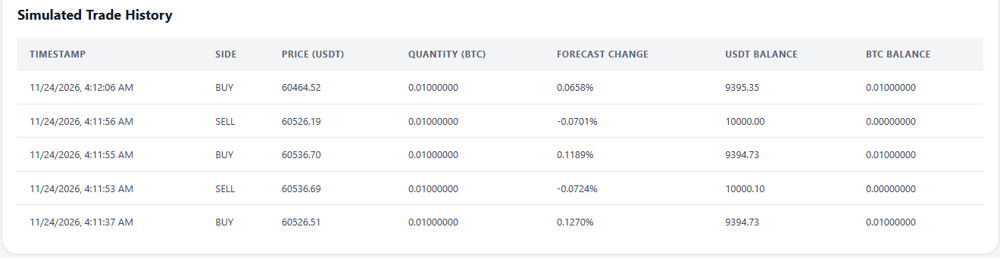
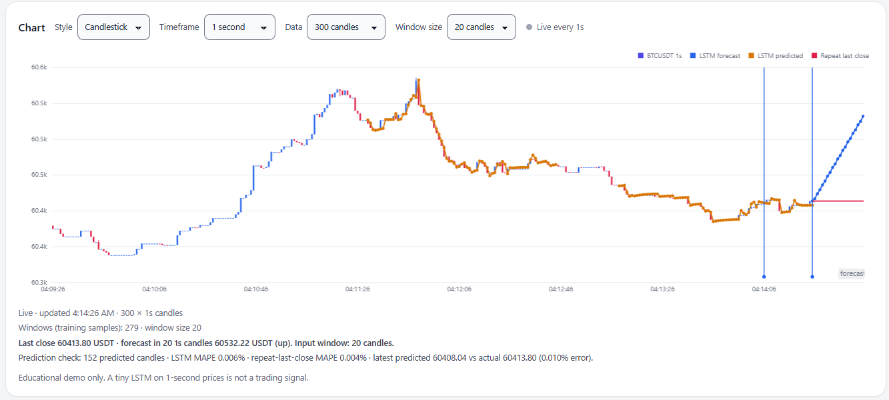
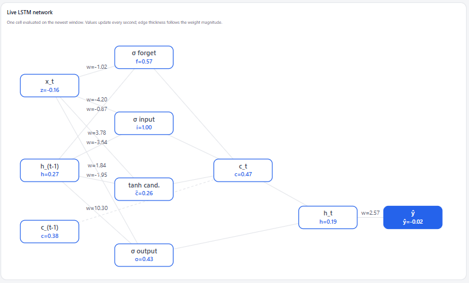
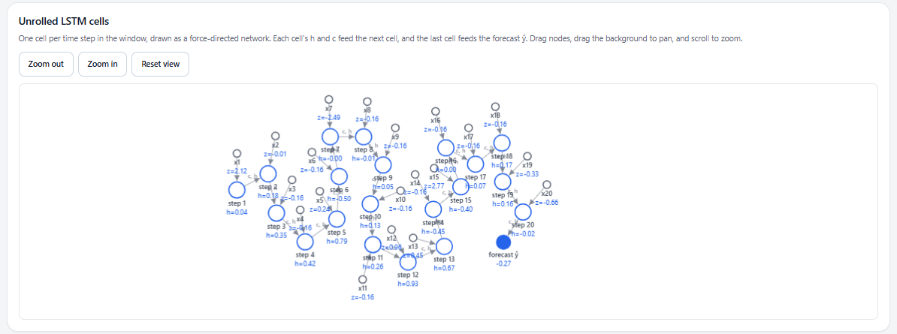

# LSTM Crypto Trading Bot (BTC/USDT)
#### Name: Yisha J. Villarin         
#### Section: IT4D

## 1. Project Overview

This project is an automated paper-trading web application developed as part of the laboratory activity on Building and Testing an LSTM Crypto Trading Bot.

It extends the existing BZUI-LSTM-BTCUSDT forecasting application provided by MSU-IIT. The original application uses a Long Short-Term Memory (LSTM) neural network to analyze historical BTC/USDT candlestick data and forecast future cryptocurrency prices.

The enhanced application integrates an automated trading mechanism that converts LSTM price forecasts into BUY, SELL, and HOLD decisions. It also includes a simulated virtual wallet, portfolio monitoring, configurable trading thresholds, and transaction history.

All transactions are simulated entirely in JavaScript. No real cryptocurrency exchange accounts, external testnet accounts, API keys, or actual funds are used.

### Reference Repository

https://github.com/msuiit-ph/BZUI-LSTM-BTCUSDT

### Technologies Used

- HTML
- CSS
- JavaScript
- TinyLSTM
- bzUI and bzChart
- Binance Public Market Data API
- GitHub Codespaces
- Python HTTP Server

### Project Architecture

| File | Description |
|---|---|
| index.html | Provides the dashboard interface, wallet information, trading controls, and visualizations. |
| app.js | Retrieves public market data, trains the LSTM model, generates forecasts, and connects the forecasts to the trading bot. |
| tiny-lstm.js | Implements the LSTM neural network and its training process. |
| unroll-graph.js | Displays the unrolled LSTM network visualization. |
| trading-bot.js | Implements the dummy wallet, trading decisions, simulated order execution, and transaction history. |
| screenshots/ | Contains actual screenshots collected during application testing. |
| README.md | Contains project documentation, configuration, setup instructions, and test results. |

## 2. Dummy Account and Trading Strategy

### 2.1 Virtual Wallet

The application uses an in-code JavaScript object to represent a simulated trading account.

The virtual wallet is initialized with:

- Initial USDT balance: 10,000.00 USDT
- Initial BTC balance: 0.00000000 BTC
- Initial portfolio equity: 10,000.00 USDT
- Initial net profit/loss: 0.00 USDT

The wallet dynamically tracks the available USDT balance, BTC holdings, active position, total portfolio equity, net profit or loss, and transaction history.

The application allows one open BTC position at a time to prevent repeated purchases while BTC is already held.

### 2.2 LSTM Signal Generation

The trading bot uses the latest closed candle price and the final predicted price of the 20-step LSTM forecast to calculate the expected percentage price change.

The formula used is:

Expected Percentage Change = ((Forecast Price - Current Price) / Current Price) × 100

The calculated percentage change is compared against a configurable threshold to determine the trading decision.

### 2.3 Trading Rules

| Signal | Condition | Action |
|---|---|---|
| BUY | Predicted change exceeds +0.05%, sufficient USDT is available, and no BTC position is open. | Purchase 0.01 BTC using simulated USDT. |
| SELL | Predicted change falls below -0.05% and BTC is currently held. | Sell the existing BTC holdings. |
| HOLD | Neither the BUY nor SELL conditions is satisfied. | Maintain the current position without executing an order. |

The threshold can be adjusted through the dashboard interface.

All simulated orders are executed at the latest closed candle price. The trading mechanism prevents duplicate evaluations of the same candle during normal operation at a fixed timeframe.

### 2.4 Portfolio Equity and Profit/Loss

The total portfolio equity is calculated using:

Total Equity = USDT Balance + (BTC Balance × Latest Closed Price)

The net profit or loss is calculated using:

Net PnL = Total Equity - Initial USDT Balance

These values are updated dynamically as new valid forecasts and market prices are received.

Transaction fees, slippage, and other exchange-related costs are not included in this simulation.

### 2.5 Model Hyperparameters and Simulation Configuration

| Parameter | Selected Value |
|---|---|
| Trading Symbol | BTCUSDT |
| Candlestick Interval | 1 second |
| Chart Style | Candlestick |
| Candle Count | 300 |
| Lookback Window | 20 candles |
| Forecast Horizon | 20 steps |
| Training Epochs per Candle | 30 |
| Learning Rate | 0.005 |
| Initial USDT Balance | 10,000.00 USDT |
| Initial BTC Balance | 0.00000000 BTC |
| BUY Threshold | +0.05% |
| SELL Threshold | -0.05% |
| Trade Quantity | 0.01 BTC |
| Maximum Open Positions | 1 |
| Execution Price | Latest closed candle price |
| Transaction Fees | Not included |
| Trading Environment | In-code JavaScript simulation |

### 2.6 Application Controls

The dashboard provides three main trading controls:

- Start Bot: Enables automated simulated trading.
- Stop Bot: Disables automated order execution while allowing market monitoring to continue.
- Reset Wallet: Stops the bot, restores the initial virtual balances, and clears the transaction history.

## 3. How to Run the Application

### Method 1: Using GitHub Codespaces

1. Open this GitHub repository.
2. Click the green Code button.
3. Select the Codespaces tab.
4. Click Create codespace on main.
5. Wait for the development environment to initialize.
6. Open the terminal.
7. Execute the following command:

```bash
python3 -m http.server 8000
```

8. Open the Ports tab.
9. Locate port 8000 and open its forwarded address in the browser.
10. Wait for the application to retrieve public BTC/USDT market data.
11. Configure the desired timeframe, candle count, window size, and trading threshold.
12. Click Start Bot to begin automated paper trading.

### Method 2: Running Locally

1. Clone the repository:

```bash
git clone https://github.com/yisha20/LSTM-Crypto-Trading-Bot.git
```

2. Navigate to the project directory:

```bash
cd LSTM-Crypto-Trading-Bot
```

3. Open the project using Visual Studio Code.
4. Install the Live Server extension or use a Python HTTP server.
5. If using Python, execute:

```bash
python3 -m http.server 8000
```

6. Open the following address in a web browser:

http://localhost:8000

7. Configure the application and click Start Bot.

An active internet connection is required to retrieve public market data and load the external dashboard libraries.

## 4. Test Results and Screenshots

The application was tested using GitHub Codespaces and a Python HTTP server running on port 8000.

The test used a one-second candlestick interval, 300 historical candles, a 20-candle lookback window, and a trading threshold of 0.05%.

### 4.1 Initial Dummy Account



The initial or reset state of the dummy account displays 10,000.00 USDT, zero BTC holdings, total equity of 10,000.00 USDT, and a net profit/loss of 0.00 USDT.

The bot is stopped, the active position is CASH, and the transaction history is empty.

This demonstrates that the virtual wallet can be initialized and restored to its starting balance.

### 4.2 Updated Dummy Account and Portfolio Summary



During the live testing session, the virtual account balances changed as the trading bot automatically executed simulated transactions.

One observed portfolio snapshot produced the following results:

| Portfolio Indicator | Observed Value |
|---|---:|
| Initial USDT Balance | 10,000.00 USDT |
| Available USDT Balance | 9,396.13 USDT |
| BTC Holdings | 0.01000000 BTC |
| Total Portfolio Equity | 10,000.07 USDT |
| Net Profit/Loss | +0.07 USDT |
| Active Position | HOLDING BTC |

These observed values demonstrate that the virtual wallet updates its USDT balance, BTC holdings, portfolio equity, and net profit/loss following simulated transactions.

Since the market data and portfolio values update continuously, the values in the captured screenshot may differ from this earlier observed snapshot.

### 4.3 Simulated Trade Execution Log



The application successfully executed automated BUY and SELL transactions based on the percentage changes generated by the LSTM model.

The following transactions were observed during an initial live testing session on November 24, 2026:

| Transaction | Side | Execution Price (USDT) | Quantity (BTC) |
|---|---|---:|---:|
| 1 | BUY | 60,384.46 | 0.01 |
| 2 | SELL | 60,391.58 | 0.01 |
| 3 | BUY | 60,394.32 | 0.01 |

The first BUY transaction purchased 0.01 BTC at 60,384.46 USDT per BTC.

The subsequent SELL transaction sold the BTC holdings at 60,391.58 USDT per BTC.

The difference between the purchase and selling prices resulted in a simulated realized profit of approximately 0.07 USDT before transaction fees.

The bot later executed another BUY transaction, demonstrating that the trading cycle could repeat automatically when the required conditions were satisfied.

The transaction history records the timestamp, trading side, execution price, BTC quantity, predicted percentage change, and updated wallet balances.

### 4.4 LSTM Forecast Chart



The forecast chart displays historical BTC/USDT candlestick data alongside the predicted future price trajectory generated by the LSTM neural network.

The model uses a 20-candle input window to forecast the next 20 steps.

The application also displays prediction accuracy information using Mean Absolute Percentage Error (MAPE).

The predicted future price is used by the trading mechanism to determine whether the bot should execute a BUY, SELL, or HOLD decision.

### 4.5 Live LSTM Network Visualization



The live LSTM network visualization displays the internal components of the LSTM cell, including:

- Forget gate
- Input gate
- Candidate cell state
- Output gate
- Cell state
- Hidden state
- Predicted output

These components update as the model processes new market data.

The visualization helps demonstrate how the LSTM model processes sequential information and produces predictions.

### 4.6 Unrolled LSTM Network Visualization



The unrolled LSTM network displays the sequential processing of the selected 20-candle input window.

Each LSTM cell passes information through its hidden state and cell state to the succeeding time step.

The final cell contributes to the forecast used by the trading mechanism.

This visualization demonstrates how historical sequential information is processed by the LSTM model.

## 5. Functional Test Results

| Functionality | Result |
|---|---|
| Public BTC/USDT market data retrieval | Passed |
| LSTM price forecasting | Passed |
| Dummy account initialization | Passed |
| Automated BUY execution | Passed |
| Automated SELL execution | Passed |
| HOLD decision | Observed |
| USDT balance updates | Passed |
| BTC balance updates | Passed |
| Portfolio equity calculation | Passed |
| Net profit/loss calculation | Passed |
| Transaction history recording | Passed |
| Start Bot control | Passed |
| Stop Bot control | Stopped state observed |
| Reset Wallet control | Reset state observed |
| Live LSTM network visualization | Passed |
| Unrolled LSTM visualization | Passed |

## 6. Limitations

The application is designed exclusively for educational and simulation purposes.

The LSTM predictions are based on historical market data and do not guarantee accurate future cryptocurrency prices.

The simulation does not include transaction fees, slippage, liquidity constraints, or other real-world trading conditions.

The virtual wallet and transaction history are stored in JavaScript memory and are cleared when the application is reloaded.

The observed short-term simulated profit does not establish the long-term profitability or reliability of the trading strategy.

## 7. Conclusion

The laboratory activity successfully demonstrates the integration of an LSTM forecasting model with an automated paper-trading mechanism.

The enhanced application retrieves public BTC/USDT market data, generates price forecasts, evaluates trading signals, executes simulated orders, and dynamically updates the virtual portfolio.

The observed BUY, SELL, and HOLD decisions demonstrate that the trading mechanism responds to LSTM predictions according to the defined trading rules.

The activity provides practical experience in sequential data processing, neural network forecasting, automated decision-making, JavaScript application development, and simulated portfolio management.

## Disclaimer

This application is strictly for academic and educational purposes. All transactions are simulated using an in-code JavaScript dummy account. No real funds, cryptocurrency exchange accounts, external testnet accounts, or private API credentials are used.
